# im-a-pm

**See your codebase the way a product manager does.** im-a-pm is an agent skill. It turns a
repository into a map of its business flows: every API route, screen, queue worker, event
handler, saga and cron job becomes a flowchart. Each flowchart runs from the trigger, through the business
decisions, to what the user gets back. You can ask questions about it, request changes from it,
and see which business rules a branch changes.

It works with **Claude Code, Codex, GitHub Copilot, Cursor and Gemini CLI**, and with any agent
that reads [Agent Skills](https://agentskills.io) (`SKILL.md`). Call it with `/im-a-pm`, or the
shorter `/imapm`.

<picture>
  <source media="(prefers-color-scheme: dark)" srcset="docs/hero-dark.png">
  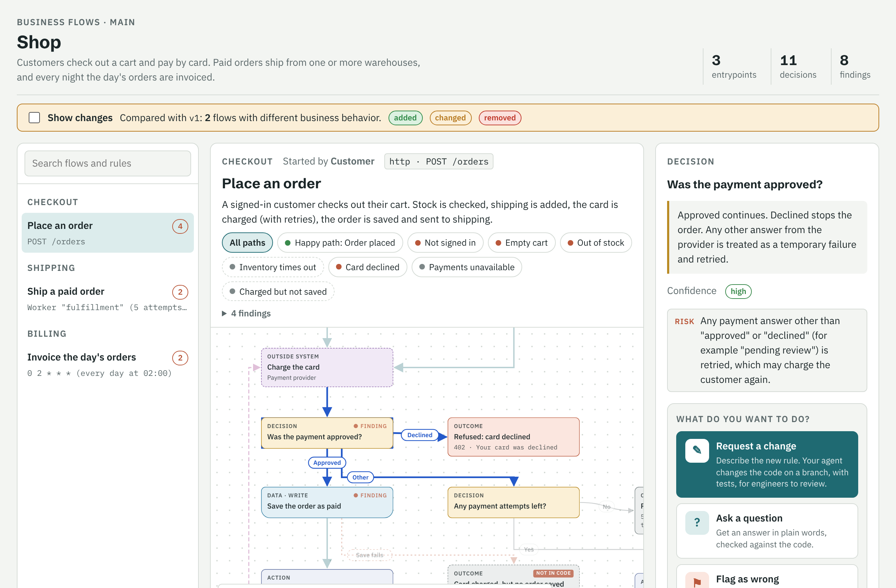
</picture>

```bash
npx github:danilojpferreira/im-a-pm install   # once, for every agent you use
/im-a-pm build                                 # in your agent, inside the repository
```

---

## Contents

- [im-a-pm](#im-a-pm)
  - [Contents](#contents)
  - [Why](#why)
  - [A tour of the viewer](#a-tour-of-the-viewer)
    - [What changed in this branch](#what-changed-in-this-branch)
    - [Ask, request a change, flag as wrong](#ask-request-a-change-flag-as-wrong)
    - [Paths the code doesn't handle](#paths-the-code-doesnt-handle)
    - [Loops and retries](#loops-and-retries)
    - [Parallel work and batches](#parallel-work-and-batches)
    - [UIs and the API they call](#uis-and-the-api-they-call)
  - [Install](#install)
  - [Commands](#commands)
  - [How it works](#how-it-works)
  - [What it maps](#what-it-maps)
  - [Examples](#examples)
  - [Helper CLI](#helper-cli)
  - [Good to know](#good-to-know)
  - [Contributing](#contributing)
  - [License](#license)

## Why

Product managers ask engineers "how does X work today?" all day. The answer is in the code,
spread across controllers, services, validation annotations, SQL filters and queue workers.
im-a-pm has your coding agent read all of that once and write it down as decisions a PM can
follow:

> **Place an order**: Is the customer signed in? → Does the cart have items? → Is every item in
> stock? → Is the order $100 or more? → Charge the card (up to 3 attempts) → Save the order →
> Send it to shipping.

Every box keeps a link to the lines it came from, a confidence grade, and the functions that run
for it, so engineers can check it. The map is a JSON file in your repository. When the code
changes, `/im-a-pm sync` re-checks only the steps whose code changed.

## A tour of the viewer

These screenshots come from [`examples/shop`](examples/shop), a small order system that uses
everything below. Every build, sync, change or diff opens the viewer in your browser by itself.
**Star** and **Report**, top right, open this project on GitHub to star it or open an issue.

Click any step and its arrows, in and out, are highlighted while the rest fade. Click empty space
to clear the selection. Where a flow forks or branches merge back together, each arrow has its
own point on the box: the straight-through branch uses the top or bottom, and the others use the
sides. Arrows run only through the gaps between steps, never across one.

### What changed in this branch

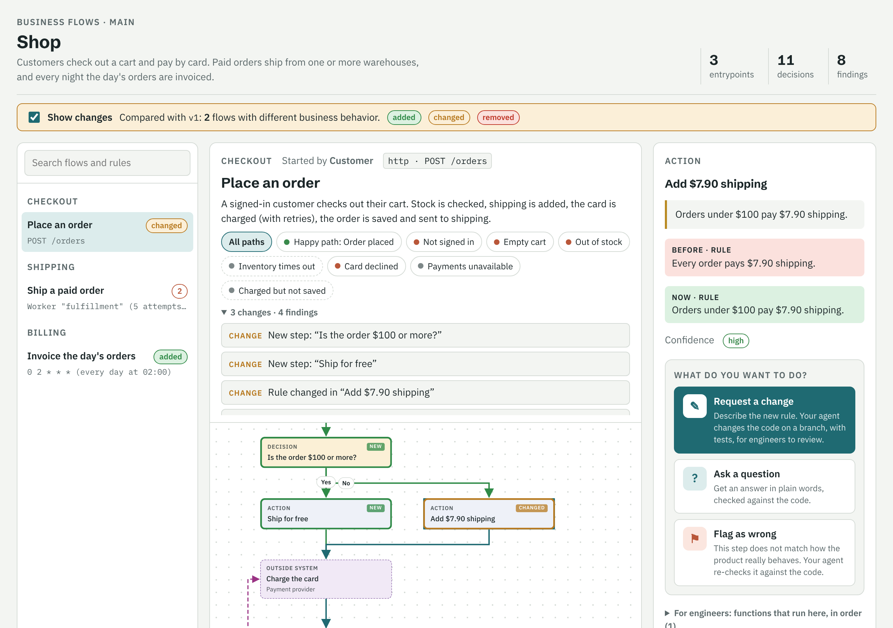

Turn on **Show changes** to compare the map with another branch or version, here `v1`.

- **Green** steps are new.
- **Amber** steps have a different rule. Click one to see the rule before and after.
- The flow list marks whole flows as *added* or *changed*.

The same diff is available as text for a pull request (`/im-a-pm diff main`):

```text
+ New flow: Invoice the day's orders
~ Place an order
    + Is the order $100 or more?
    + Ship for free
    ~ Add $7.90 shipping (rule): "Every order pays $7.90 shipping." → "Orders under $100 pay $7.90 shipping."
```

### Ask, request a change, flag as wrong

<table>
  <tr>
    <td width="50%">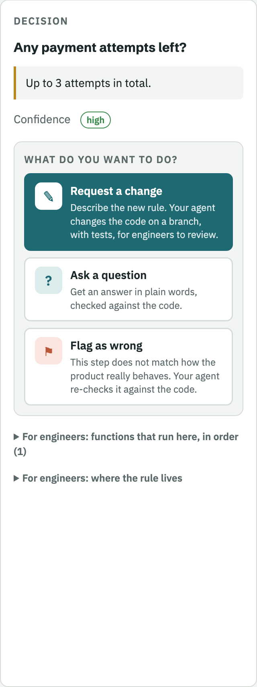</td>
    <td width="50%">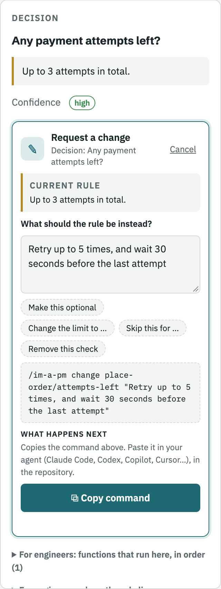</td>
  </tr>
</table>

Every step, and every flow, ends with **What do you want to do?**

| Action | What you write | What happens |
| --- | --- | --- |
| **Request a change** (the main action) | The new rule, in business words: "Retry up to 5 times". The current rule is shown above the box, with suggested wordings below it. | Your agent restates it as *current rule → new rule* and lists the other flows affected. It then changes the code on an `im-a-pm/<slug>` branch with tests, updates the map, and shows the behavioral diff. Nothing is pushed. |
| **Ask a question** | "Why does this exist?" or "What happens if the provider times out?" | The answer comes back in product language, checked against the code, and names the steps it relies on. |
| **Flag as wrong** | What you see in the real product. | Your agent re-checks that step against the code, then fixes the map or explains why it is right. |

**Copy command** puts a ready-to-paste command on your clipboard, such as
`/im-a-pm change place-order/attempts-left "Retry up to 5 times"`. Paste it in your agent (Claude
Code, Codex, Copilot, Cursor…), in the repository. The command is also shown in the panel, so you
can check it first.

When the map is published as a [Claude artifact](https://claude.ai), *Ask* goes straight to
Claude instead. The answer cites the steps, which light up on the chart, and that page also has a
search box for questions about any business rule.

### Paths the code doesn't handle

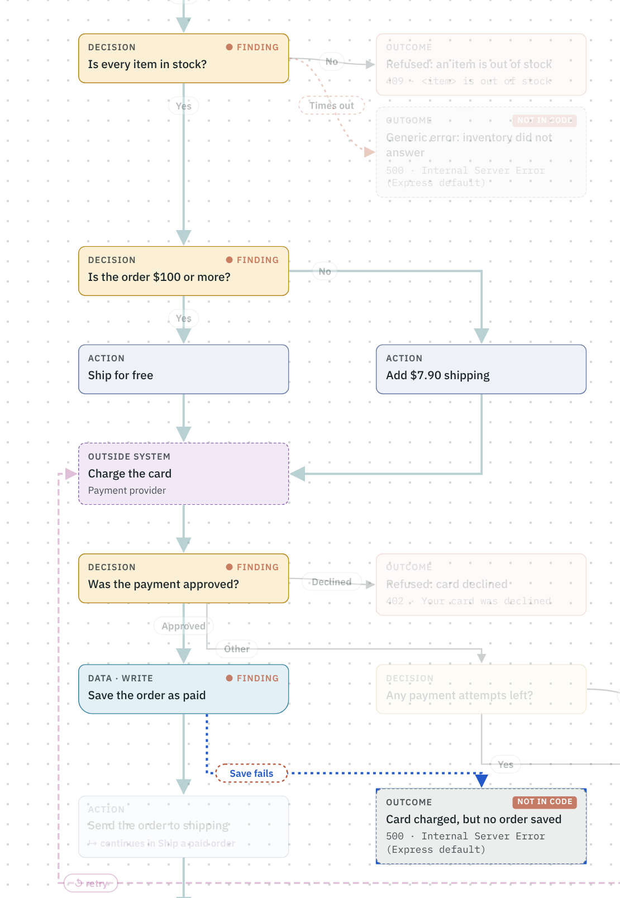

Some of the most important behavior is what nobody wrote code for: an uncaught error, a missing
`else`, a failure right after a side effect. The map shows these as **dashed paths and outcomes
tagged NOT IN CODE**, with what happens by default. In the shop, if saving the order fails
after the card is charged, the customer pays, gets a generic error, and nothing refunds them. The
agent records these deliberately and adds them to the flow's findings.

### Loops and retries

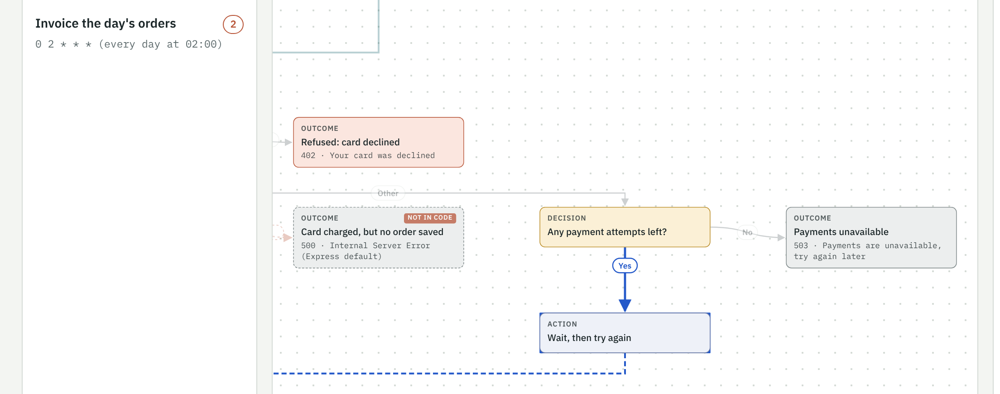

Repetition is drawn as a **dashed arrow up the left side**, labelled with what repeats: a retry,
the next page, the next batch. The condition that ends it ("Any payment attempts left?") and the
limits ("up to 3 attempts, waiting 1 s then 2 s") are part of the map. Following a path
includes the steps it repeats, both in the viewer and in `trace`.

### Parallel work and batches

<table>
  <tr>
    <td width="50%">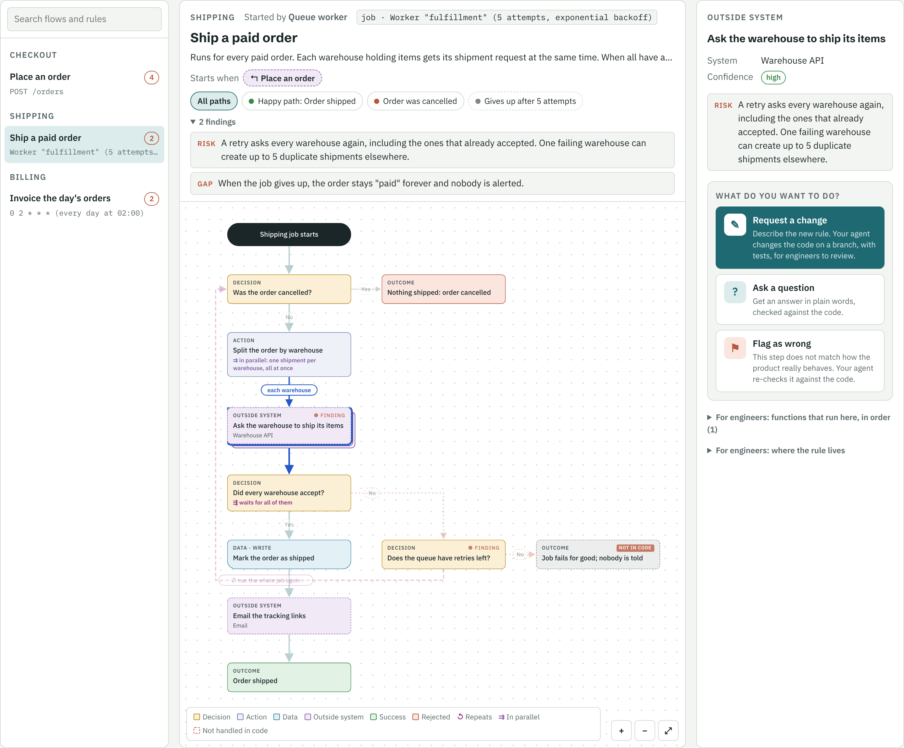</td>
    <td width="50%">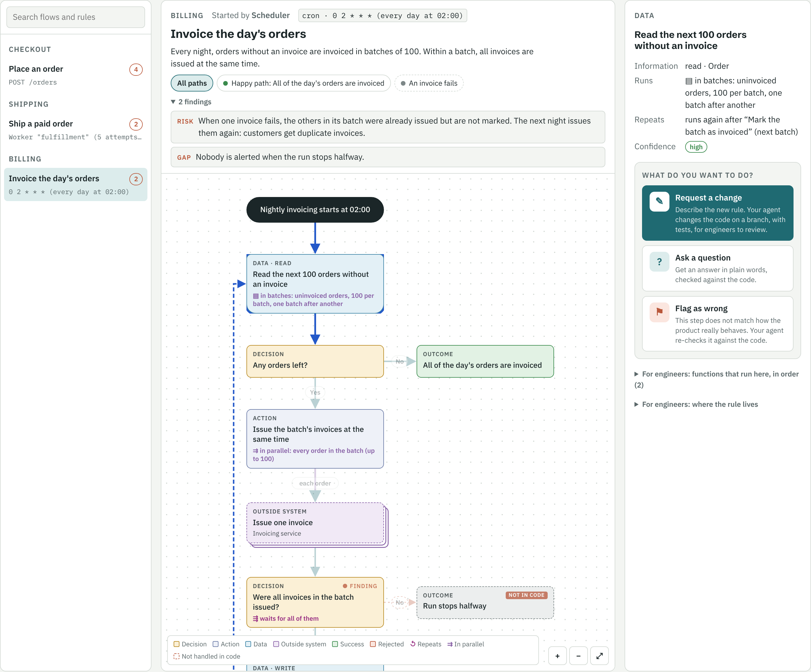</td>
  </tr>
</table>

- **Parallel** (left): the step that splits the work says what it splits ("one shipment per
  warehouse, all at once"). The work done per item is drawn as **stacked cards**. The step that
  waits for it says what it waits for ("all of them") and what happens when one fails.
- **Batches** (right): nightly invoicing reads 100 orders at a time, issues that batch's invoices
  in parallel, and loops to the next batch until none are left.

The findings point out what this structure hides. Here: a retry asks every warehouse again,
including the ones that already accepted, so one failure can create duplicate shipments. And
when an invoice fails, the batch isn't marked as invoiced, so customers get duplicate invoices.

### UIs and the API they call

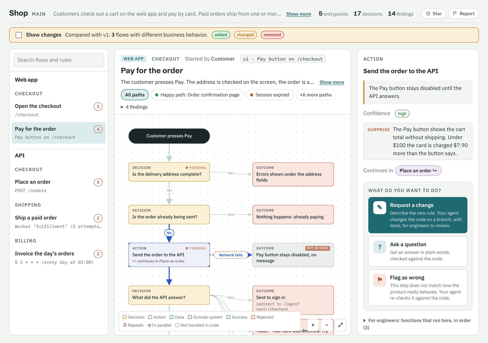

A web or mobile frontend is mapped the same way. A flow starts when a page opens or a person
uses a control, and ends with what they see: a page, a message, a toast. The decisions are the
ones that matter to the product: who may see the page, form rules, limits, feature flags, what
happens on each answer from the API. Layout and styling are left out.

When a screen calls the API, the step lists the route it calls. If that
route is in the same repository, the two are linked: the screen's step **continues in** the API
flow, and the API flow says it is **Called from** the screen. `trace --follow` reads straight
through, from the button press to the database and back. In a monorepo, each flow names the app
it belongs to (`web`, `mobile`, `api`), and the sidebar groups them.

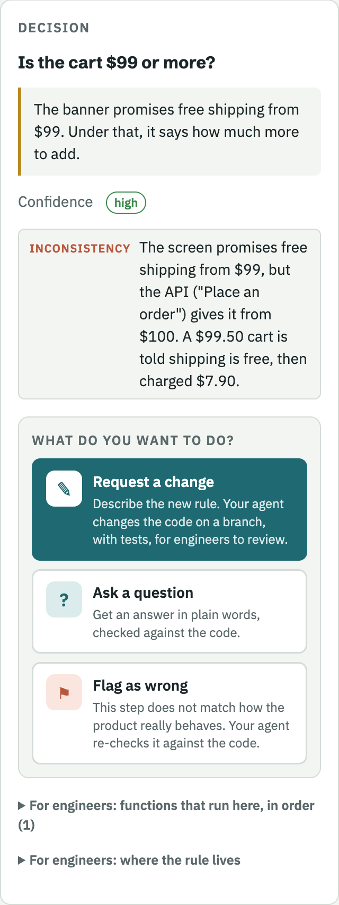

Mapping both sides finds the rules that drifted apart, which is not visible from the screen's code or the API's code alone.

<br clear="right">

## Install

```bash
npx github:danilojpferreira/im-a-pm install                    # all agents, your user account
npx github:danilojpferreira/im-a-pm install --agent codex      # one agent
npx github:danilojpferreira/im-a-pm install --project          # this repository only
npx github:danilojpferreira/im-a-pm install --dir ~/my/skills  # any folder
npx github:danilojpferreira/im-a-pm uninstall                  # same options
```

The installer copies two skill folders, `im-a-pm` and its alias `imapm`, to where your agents
look for skills. By default that is `~/.claude/skills` and `~/.agents/skills`, which between them
cover every agent below. It needs Node 18+.

| Agent | `--agent` | User install | `--project` install | How to call it |
| --- | --- | --- | --- | --- |
| Claude Code | `claude` | `~/.claude/skills` | `.claude/skills` | `/im-a-pm build` |
| Codex | `codex` | `~/.agents/skills` | `.agents/skills` | `$im-a-pm build`, or pick it from `/skills` |
| GitHub Copilot (agent mode, CLI, cloud agent) | `copilot` | `~/.copilot/skills` | `.github/skills` | "use im-a-pm to build the map" |
| Cursor | `cursor` | `~/.cursor/skills` | `.cursor/skills` | "use im-a-pm to build the map" |
| Gemini CLI | `gemini` | `~/.gemini/skills` | `.gemini/skills` | "use im-a-pm to build the map" |

Agents that support slash commands for skills accept `/im-a-pm build` and `/imapm build`. Every
agent also picks the skill up from a plain request, such as "map this repo for a PM" or "what
business rules did this branch change?".

<details>
<summary>Other ways to install</summary>

**Claude Code plugin marketplace**

```text
/plugin marketplace add danilojpferreira/im-a-pm
/plugin install im-a-pm@im-a-pm
```

**From a clone**

```bash
git clone https://github.com/danilojpferreira/im-a-pm
node im-a-pm/skills/im-a-pm/scripts/im-a-pm.mjs install
```

**By hand.** Copy `skills/im-a-pm` and `skills/imapm` into your agent's skills folder. Keep them
side by side, because the alias reads `../im-a-pm/SKILL.md`.

**Notes**

- Copilot reads `.claude/skills`, `.github/skills` and `.agents/skills` in a project. If you
  install in more than one of them you'll see the skill twice, so install with
  `--agent copilot` only.
- Older Codex versions read `~/.codex/skills`. Use `--dir ~/.codex/skills` for those.

</details>

## Commands

Every command works as `/im-a-pm …` or `/imapm …`.

| Command | What happens |
| --- | --- |
| `build` | Finds every entrypoint, traces each one to every outcome, writes the map, stamps it with the current commit, and opens it. |
| `sync` | Updates the map from its recorded commit to `HEAD`. Line references move, changed steps are marked "re-check", new entrypoints are flagged, and the agent re-checks only those. |
| `view` | Opens the current map. |
| `ask "<question>"` | Answers in product language, checked against the code, and names the steps involved. |
| `change <flow>[/<step>] "<request>"` | Restates the rule (current → new) and lists the flows affected. It then implements the change on an `im-a-pm/<slug>` branch with tests, updates the map, and shows the behavioral diff. Nothing is pushed. |
| `diff [<base-ref>]` | Compares business behavior with another branch (by default, the main branch) and opens the map with the changes highlighted. |

## How it works

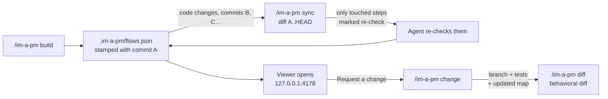

**The map** is one JSON file, `.im-a-pm/flows.json`. Commit it, so that every branch and pull
request carries its own map. Each flow is a small graph of steps:

| Step | Drawn as | Example |
| --- | --- | --- |
| Trigger | dark pill | "Customer places an order" |
| Decision | yellow | "Is the order $100 or more?" |
| Action | blue-grey | "Add $7.90 shipping" |
| Data | blue | "Save the order as paid" |
| Outside system | purple | "Charge the card" (payment provider) |
| Outcome | green, red or grey | "Order placed", "Card declined", "Payments unavailable" |

Every step carries:

- the business rule in plain words
- a confidence grade: `high` (read in the code), `medium` (inferred) or `low` (guessed)
- a link to the line where the rule lives
- the functions that run for it, in order, including what the framework runs from annotations
  and decorators

Edges can **repeat** (`loop`), steps can **split** and **join** work (`fanout`, `join`), anything
the code doesn't handle is marked `implicit`, and asynchronous hand-offs link one flow to the next
(`emits`, `trigger.channel`). The full format is in
[`skills/im-a-pm/reference/schema.md`](skills/im-a-pm/reference/schema.md).

**Your agent does the reading. A small script does the bookkeeping.** Understanding code needs a
model, so building and re-checking the map is the agent's job. The skill ships a dependency-free
Node script for everything that should be exact:

- checking the map
- the line-level git diff behind `sync`
- behavioral diffs and function traces
- rendering and serving the viewer

**Sync is incremental.** `app.commit` records the commit the map describes. `sync` reads
`git diff <app.commit> HEAD`, moves every line reference to where that code is now, and marks a
step stale only if a changed block overlaps the functions listed for it. In the `video-api`
example, a teammate's commit changed 5 files, and sync flagged 1 step out of 43, plus the new
endpoint.

## What it maps

Entrypoints across common stacks:

- REST and RPC routes: Spring, NestJS, Express/Fastify/Koa, Next.js, FastAPI/Flask/Django, Rails,
  Laravel, Go, gRPC
- GraphQL resolvers
- message and event consumers: Kafka, RabbitMQ, SQS/SNS, Pub/Sub, in-process domain events
- webhooks
- cron jobs and schedulers
- queue workers: BullMQ, Sidekiq, Celery
- sagas and workflows: Temporal, Step Functions, NestJS CQRS sagas
- CLI commands
- frontends: pages and user actions in React Router, Next.js, Remix, SvelteKit, Nuxt, Vue,
  Angular and React Native/Expo, linked to the API routes they call
- monorepos: one map for the whole repository, each flow tagged with its app

The guide the agent follows is
[`skills/im-a-pm/reference/entrypoints.md`](skills/im-a-pm/reference/entrypoints.md).
Declarative code is traced as part of the flow, not skipped: annotations and decorators, DI
containers, validation pipes, exception mappers, ORM query filters and config flags.

## Examples

| Example | What it is | Look at |
| --- | --- | --- |
| [`examples/video-api`](examples/video-api) | A real Spring Boot API, mapped end to end: a build, a change request that went through tests, and a sync after a teammate's commit. | `sync-report.txt`, `diff.txt`, `trace-publish-video.txt` |
| [`examples/shop`](examples/shop) | A small order system written for these docs: a React checkout and the API behind it, with a payment retry loop, parallel shipping, nightly batches, and paths the code doesn't handle. The map was written by hand for the docs; every line reference points at the code in `src/`. | `index.html` with **Show changes** on, `change-v1-to-now.diff` |

Open either `index.html` in a browser.

## Helper CLI

The agent runs it for you, but you can too. It needs Node 18+ and has no dependencies. Run it
from the repository root.

```text
im-a-pm validate [flows.json]                    check the map
im-a-pm render   [--base base.json] [--no-open]  write .im-a-pm/index.html and open it
im-a-pm view                                     open the current map
im-a-pm sync     [--since <commit>]              update line refs, mark changed steps, stamp HEAD
im-a-pm stamp                                    record HEAD as the commit the map describes
im-a-pm trace    <flow> [<outcome>] [--follow]   functions on a path, in order, across hand-offs
im-a-pm diff     <base.json> <head.json>         behavioral diff
im-a-pm stop                                     stop the viewer server
im-a-pm install | uninstall [--agent …] [--project] [--dir …]
```

Run it with `npx github:danilojpferreira/im-a-pm <command>`, or with
`node <skills-folder>/im-a-pm/scripts/im-a-pm.mjs <command>`. The viewer is served on
`127.0.0.1:4178`, or the next free port, and an open tab reloads itself after each render. Set
`IM_A_PM_NO_OPEN=1` to never open a browser.

## Good to know

- **The map describes committed code.** `sync` reads `app.commit..HEAD`. Uncommitted changes are
  reported, not mapped.
- **It is as accurate as the reading.** That's why every step has a confidence grade, a code
  link and a "Flag as wrong" action, and why `ask` checks the code before answering.
- **Sync sees what the map lists.** A changed function that no step lists is not flagged.
  Changed files the map never references are always reported for review.
- **Shallow clones**: if the recorded commit isn't in your clone, fetch more history
  (`git fetch --deepen=200`) or rebuild.
- **Large repositories**: build one domain at a time ("build the map for the billing module").
- **Your code stays with you.** The script runs locally and the viewer is served on
  `127.0.0.1`. The only thing that reads your code is the agent you already use.

**Status: version 0.5.** Tested end to end on a Spring Boot REST service (`examples/video-api`).
Loops, parallel work, batches and unhandled paths are covered by tests and the shop example, but
haven't yet been mapped from a large real codebase with queues and sagas. The same goes for
frontends and monorepos, so far covered only by the shop example. CI tests the CLI on Linux,
macOS and Windows. Opening the browser on Windows and WSL is implemented but not tested yet.
Issues and examples from real codebases are very welcome.

## Contributing

```bash
npm test        # node:test suite: validation, loops and splits, diff, sync against a real git repo, trace, render, install, server
npm run check   # regenerate the examples and fail if anything in them changed
```

See [`AGENTS.md`](AGENTS.md) for how the repository is laid out and what to keep in sync.

## License

[MIT](LICENSE) © Danilo Pereira
