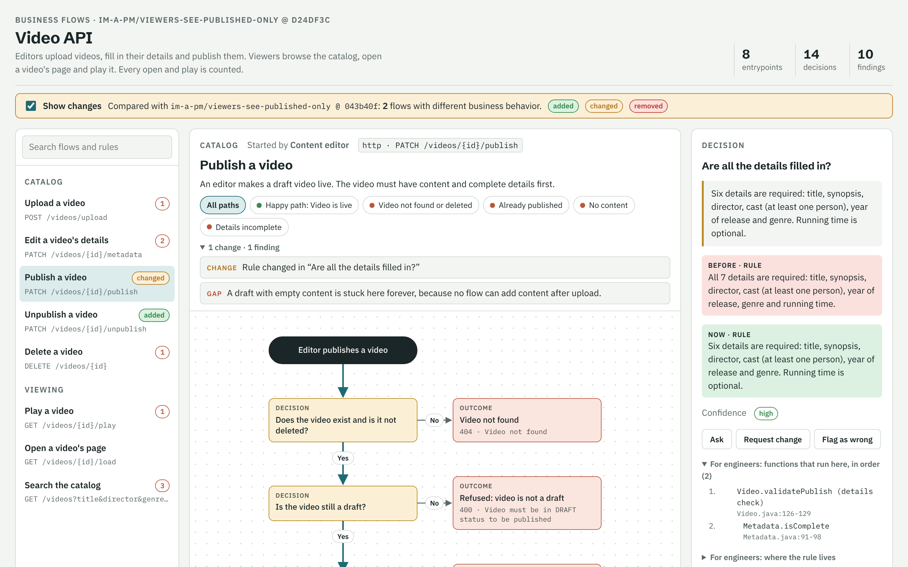
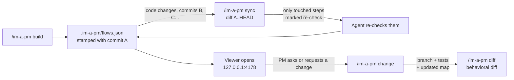

# im-a-pm

**See your codebase the way a product manager does.** im-a-pm is an agent skill that turns a
repository into a map of business flows. Every entrypoint becomes a flowchart: an API route, a
queue worker, an event handler, a saga, a cron job. Each flowchart runs from the trigger, through
the business decisions, to what the user gets back. You can ask questions about it, request
changes from it, and see which business rules a branch changes.

It works with **Claude Code, Codex, GitHub Copilot, Cursor and Gemini CLI**, and with any other
agent that reads [Agent Skills](https://agentskills.io) (`SKILL.md`). Use `/im-a-pm`, or the
shorter `/imapm`.



---

## Why

Product managers ask engineers "how does X work today?" all day. The answer is in the code,
spread across controllers, services, validation annotations, SQL filters and queue workers.
im-a-pm has your coding agent read all of that once and write it down as decisions a PM can
follow:

> **Publish a video**: Does the video exist and is it not deleted? → Is it still a draft? →
> Does it have content? → Are all six details filled in? → Video is live.

Every box keeps a link to the exact lines it came from, so engineers can check it.

## What you get

- **One flowchart per entrypoint**, in product language: decisions are yes/no questions, rules
  carry their real values ("year of release must be 1878 or later"), and every alternate outcome
  has a name.
- **Findings**: what a PM would be surprised by. Examples: "drafts appear in search results",
  "a video uploaded without content can never be published", "the code comment says partial
  match, the query needs an exact name".
- **The function order of every path**, folded away under "For engineers". This includes what the
  framework runs for you: routing, validation, exception handlers, guards, query filters.
- **Linked asynchronous flows.** When checkout puts a job on a queue, you can click through to
  the worker that picks it up.
- **Sync.** The map records the commit it describes. `sync` reads what changed since then,
  re-checks only the affected steps, and flags new entrypoints.
- **Change requests.** A PM writes "only published videos should be playable". The agent turns it
  into a tested change on its own branch for engineers to review. It never pushes on its own.
- **Behavioral diffs.** "This branch adds the Unpublish flow and makes running time optional for
  publishing," instead of a list of changed files.
- **A viewer that opens itself.** Every build, sync, change or diff serves the map locally and
  opens it in your browser. A tab that is already open reloads in place.

## Quick start

```bash
# 1. Install the skills for every supported agent (needs Node 18+)
npx github:danilojpferreira/im-a-pm install

# 2. In the repository you want to map, start your agent and run:
/im-a-pm build
```

The agent inventories the entrypoints, traces each one, writes `.im-a-pm/flows.json`, and opens
the map at `http://127.0.0.1:4178`. Commit `.im-a-pm/flows.json` so that every branch and pull
request carries its own map.

## Install

The installer copies two skill folders, `im-a-pm` and its alias `imapm`, to where your agents
look for skills. By default it installs for your user account (all projects) in
`~/.claude/skills` and `~/.agents/skills`. Between them, those two folders cover every agent
below.

```bash
npx github:danilojpferreira/im-a-pm install                    # all agents, your user account
npx github:danilojpferreira/im-a-pm install --agent codex      # one agent
npx github:danilojpferreira/im-a-pm install --project          # this repository only
npx github:danilojpferreira/im-a-pm install --dir ~/my/skills  # any folder
npx github:danilojpferreira/im-a-pm uninstall                  # same options
```

| Agent | `--agent` | User install | `--project` install | How to call it |
|---|---|---|---|---|
| Claude Code | `claude` | `~/.claude/skills` | `.claude/skills` | `/im-a-pm build` |
| Codex | `codex` | `~/.agents/skills` | `.agents/skills` | `$im-a-pm build`, or pick it from `/skills` |
| GitHub Copilot (agent mode, CLI, cloud agent) | `copilot` | `~/.copilot/skills` | `.github/skills` | "use im-a-pm to build the map" |
| Cursor | `cursor` | `~/.cursor/skills` | `.cursor/skills` | "use im-a-pm to build the map" |
| Gemini CLI | `gemini` | `~/.gemini/skills` | `.gemini/skills` | "use im-a-pm to build the map" |

Agents that support slash commands for skills accept `/im-a-pm build` and `/imapm build`. Every
agent also picks the skill up from a plain request, such as "map this repo for a PM" or "what
business rules did this branch change?".

<details>
<summary>Other ways to install</summary>

**Claude Code plugin marketplace**

```text
/plugin marketplace add danilojpferreira/im-a-pm
/plugin install im-a-pm@im-a-pm
```

**From a clone**

```bash
git clone https://github.com/danilojpferreira/im-a-pm
node im-a-pm/skills/im-a-pm/scripts/im-a-pm.mjs install
```

**By hand.** Copy `skills/im-a-pm` and `skills/imapm` into your agent's skills folder. Keep them
side by side, because the alias reads `../im-a-pm/SKILL.md`.

**Notes**
- Copilot reads `.claude/skills`, `.github/skills` and `.agents/skills` in a project. If you
  install in more than one of them, you'll see the skill twice. Install with `--agent copilot`
  only.
- Older Codex versions read `~/.codex/skills`. Use `--dir ~/.codex/skills` for those.

</details>

## Commands

Every command works as `/im-a-pm …` or `/imapm …`.

| Command | What happens |
|---|---|
| `build` | Finds every entrypoint, traces each one to every outcome, writes the map, stamps it with the current commit, and opens it. |
| `sync` | Updates the map from its recorded commit to `HEAD`. Line references move, changed steps are marked "re-check", new entrypoints are flagged, and the agent re-checks only those. |
| `view` | Opens the current map. |
| `ask "<question>"` | Answers in product language, checked against the code, and names the steps involved. |
| `change <flow>[/<step>] "<request>"` | Restates the rule (current → new) and lists the flows affected. It then implements the change on an `im-a-pm/<slug>` branch with tests, updates the map, and shows the behavioral diff. Nothing is pushed. |
| `inbox` | Processes questions, change requests and "flag as wrong" reports sent from the viewer. |
| `diff [<base-ref>]` | Compares business behavior with another branch (by default, the main branch) and opens the map with the changes highlighted. |

## How it works



**The map** is one JSON file, `.im-a-pm/flows.json`. Each flow is a small graph with six kinds
of steps: the trigger, *decisions*, *actions*, *data* (saved or read), *external* calls (payment
providers, email, other services) and *outcomes*. Each step has:
- the business rule in plain words
- a confidence grade (`high` when read directly in the code, `medium` when inferred, `low` when
  guessed)
- a link to the line where the rule lives
- the ordered list of functions that run for it

The full format is in [`skills/im-a-pm/reference/schema.md`](skills/im-a-pm/reference/schema.md).

**Your agent does the reading. A small script does the bookkeeping.** Understanding code needs a
model, so building and re-checking the map is the agent's job. The skill ships a dependency-free
Node script for everything that should be exact: checking the map, the line-level git diff behind
`sync`, behavioral diffs, function traces, and rendering and serving the viewer. Nothing is sent
anywhere except by your agent.

**Sync is incremental.** `app.commit` records the commit the map describes. `sync` reads
`git diff <app.commit> HEAD` and moves every line reference to where that code is now. It marks a
step stale only if a changed block overlaps the functions listed for that step. In the example
below, a teammate's commit changed 5 files: sync flagged 1 step out of 43, found the new endpoint,
and shifted the line numbers of everything else.

## The viewer

- **Flow list** grouped by domain, with search across titles and rules, plus finding counts and
  diff badges.
- **Flowchart** with the happy path running down the left and rejections branching to the right.
  Path buttons follow one outcome at a time. You can drag, scroll and zoom.
- **Step details**: the exact rule, confidence, findings, before → after when it changed, the
  "continues in" links for asynchronous hand-offs, and, folded away for engineers, the functions
  in order and where the rule lives.
- **Ask, Request change, Flag as wrong** on every step. When the viewer is served (the default),
  these land in `.im-a-pm/requests/` for `/im-a-pm inbox`. When it is opened as a plain file, it
  copies a ready-to-paste command instead.
- **Opens itself, reloads itself.** `build`, `sync`, `change`, `diff` and `view` start a small
  local server (port 4178, or the next free one) and open your browser. An open tab reloads when
  the map changes. On a machine without a browser (SSH, containers, CI) you get the URL instead.
  Set `IM_A_PM_NO_OPEN=1` to never open a tab, and run `im-a-pm stop` to stop the server.
- **AI search** across all business rules, with answers that cite and highlight the steps they
  rely on. It appears when the page is published as a [Claude artifact](https://claude.ai), which
  lets the page ask Claude. A plain local file has no model to ask, so the box stays hidden there.

## What it maps

Entrypoints across common stacks: REST and RPC routes (Spring, NestJS, Express/Fastify/Koa,
Next.js, FastAPI/Flask/Django, Rails, Laravel, Go, gRPC), GraphQL resolvers, message and event
consumers (Kafka, RabbitMQ, SQS/SNS, Pub/Sub, in-process domain events), webhooks, cron and
schedulers, queue workers (BullMQ, Sidekiq, Celery), sagas and workflows (Temporal, Step
Functions, NestJS CQRS sagas), and CLI commands. The guide the agent follows is
[`skills/im-a-pm/reference/entrypoints.md`](skills/im-a-pm/reference/entrypoints.md).

Declarative code is the point, not an edge case. Annotations and decorators, DI containers,
validation pipes, exception mappers, ORM query filters and config flags are traced as part of
the flow, with a `kind` that says the framework runs them.

## Example: `video-api`

[`examples/video-api/`](examples/video-api/) is a real run on a Spring Boot API. Open
`index.html` to explore it. It covers three stages:

1. **Build**: 7 entrypoints, 10 decisions and 13 findings. Some of them: drafts showed up in
   search and could be played by anyone with the link; a video uploaded with empty content could
   never be published; there was no way to unpublish or restore.
2. **Change**: "Viewers should only see published videos." The agent found 3 affected flows,
   changed 2 files, fixed the 2 tests that assumed the old behavior and added 2 more. All 38 tests
   passed. The behavioral diff showed exactly the 3 flows
   ([`change-published-only.diff`](examples/video-api/change-published-only.diff)).
3. **Sync**: a teammate's commit added an unpublish endpoint and made running time optional.
   [`sync-report.txt`](examples/video-api/sync-report.txt) flagged 1 step out of 43, plus the new
   route. After the re-check, the diff reads "+ New flow: Unpublish a video; ~ Publish a video:
   six details are required, running time is optional"
   ([`diff.txt`](examples/video-api/diff.txt)).

[`trace-publish-video.txt`](examples/video-api/trace-publish-video.txt) shows the 19 functions of
the publish happy path, from routing to response.

## Helper CLI

The agent runs it for you, but you can too. It needs Node 18+ and has no dependencies. Run it
from the repository root.

```text
im-a-pm validate [flows.json]                    check the map
im-a-pm render   [--base base.json] [--no-open]  write .im-a-pm/index.html and open it
im-a-pm view                                     open the current map
im-a-pm sync     [--since <commit>]              update line refs, mark changed steps, stamp HEAD
im-a-pm stamp                                    record HEAD as the commit the map describes
im-a-pm trace    <flow> [<outcome>] [--follow]   functions on a path, in order
im-a-pm diff     <base.json> <head.json>         behavioral diff
im-a-pm stop                                     stop the viewer server
im-a-pm install | uninstall [--agent …] [--project] [--dir …]
```

Run it with `npx github:danilojpferreira/im-a-pm <command>`, or with
`node <skills-folder>/im-a-pm/scripts/im-a-pm.mjs <command>`.

## Good to know

- **The map describes committed code.** `sync` reads `app.commit..HEAD`. Uncommitted changes are
  reported, not mapped.
- **It is as accurate as the reading.** That's why every step has a confidence grade, a code
  link and a "Flag as wrong" button, and why `ask` checks the code before answering.
- **Sync sees what the map lists.** A changed function that no step lists is not flagged.
  Changed files the map never references are always reported for review.
- **Shallow clones**: if the recorded commit isn't in your clone, fetch more history
  (`git fetch --deepen=200`) or rebuild.
- **Large repositories**: build one domain at a time ("build the map for the billing module").
- **Your code stays with you.** The script runs locally and the viewer is served on
  `127.0.0.1`. The only thing that reads your code is the agent you already use.

## Status

Version 0.3. It has been tested end to end on a Spring Boot REST service (the example above).
The asynchronous parts are designed, documented and covered by tests, but haven't been through a
real repository yet: queues, events, sagas and links between flows. The CLI is tested on Linux.
CI also runs it on macOS. Opening the browser on Windows and WSL is implemented but not tested yet.
Issues and examples from real codebases are very welcome.

## Contributing

```bash
npm test        # node:test suite: validation, diff, sync against a real git repo, trace, render, install, server
npm run check   # validate the example map
```

See [`AGENTS.md`](AGENTS.md) for how the repository is laid out and what to keep in sync.

## License

[MIT](LICENSE) © Danilo Pereira
